# PROJETO DE INTELIGÊNCIA DE NEGÓCIOS

## Análise da Demonstração do Resultado (DRE) – WEG

**Autor:** Carolina Muro Gomes

**Ferramenta:** Power BI

**Tecnologias:** Power Query, DAX, Modelagem Dimensional

## 1. Cenário de Negócio

### 1.1 Conhecendo a Empresa WEG

A WEG é uma empresa brasileira global de bens de capital, especializada em equipamentos e soluções eletroeletrônicas. Seu amplo catálogo de produtos abrange motores e acionamentos elétricos, automação industrial, geração, transmissão e distribuição de energia, sistemas digitais e tintas e vernizes industriais.

Suas soluções tecnológicas impactam diretamente setores dos mais diversos, conectando indústrias tradicionais, como óleo e gás, mineração, siderurgia e construção civil, a mercados em transformação, como energias renováveis, mobilidade elétrica, soluções digitais e infraestrutura para data centers.

Por atuar em diferentes setores e mercados ao redor do mundo, a WEG está exposta a fatores que podem influenciar seus resultados, como variações de câmbio, custos de matérias-primas, taxas de juros e mudanças na atividade econômica. Ao mesmo tempo, a acelerada evolução tecnológica, somada à expansão das energias renováveis, da mobilidade elétrica, da automação industrial e da infraestrutura digital, criam novas oportunidades de crescimento. Nesse cenário, acompanhar a evolução das receitas, custos e resultados da companhia ajuda a entender como a empresa vem respondendo financeiramente a essas mudanças ao longo do tempo.

**1.2 Aspecto de Negócio:** **O papel da DRE na gestão financeira**

A Demonstração do Resultado do Exercício (DRE) apresenta, de forma estruturada, as receitas, custos, despesas e resultados de uma empresa em determinado período. Mais do que demonstrar o lucro ou prejuízo, ela permite acompanhar o desempenho financeiro da empresa, observar a evolução de seus principais resultados e identificar variações relevantes ao longo do tempo.

Essas informações apoiam diferentes áreas da empresa, como diretoria, controladoria, contabilidade e finanças, no acompanhamento dos resultados e na tomada de decisões. Externamente, a DRE também é uma importante fonte de informação para acionistas, investidores e analistas de mercado, contribuindo para a avaliação da saúde financeira, da rentabilidade e da evolução dos resultados da companhia.

## 2. Justificativa de Projeto

### 2.1 Proposta e Valor da Solução

O projeto propõe a construção de uma estrutura automatizada de análise da **Demonstração do Resultado (DRE)**, reduzindo a necessidade de preparação manual recorrente das informações financeiras. Uma vez estruturado o fluxo de tratamento, modelagem e cálculo dos indicadores, novos períodos podem ser incorporados ao modelo com menor intervenção operacional, permitindo a atualização das análises de forma padronizada.

Do ponto de vista empresarial, a solução tem potencial para:

1.  Reduzir horas dedicadas à consolidação, preparação e atualização de relatórios

2.  Diminuir retrabalho decorrente de processos manuais.

3.  Aumentar a produtividade, permitindo que profissionais das áreas financeira e de controladoria concentrem maior parcela de seu tempo na análise dos resultados, em vez da preparação dos dados.

4.  Reduzir inconsistências entre análises realizadas em arquivos distintos e agilizar a disponibilização de informações gerenciais por meio da padronização dos cálculos.

5.  Aumentar a eficiência operacional e reduzir custos associados à produção recorrente de relatórios financeiros.

Além da construção da DRE gerencial, a solução foi ampliada com um **Simulador de Resultados**, permitindo ao usuário testar diferentes cenários por meio da alteração de variáveis como receita, custos, despesas, resultado financeiro e impostos. A partir dos parâmetros definidos, o dashboard recalcula automaticamente os resultados simulados e permite compará-los aos valores realizados, apoiando análises de cenários e avaliação do impacto de diferentes premissas sobre o Resultado final. A solução também incorpora uma camada de **Análise Financeira**, com indicadores de crescimento e rentabilidade, como CAGR da Receita e do Resultado Final, Margem Bruta, Margem EBIT e Margem Líquida, além de visualizações voltadas à evolução das margens, ao crescimento anual dos principais resultados e à composição da receita até o resultado final. Dessa forma, o dashboard complementa a visualização tradicional da DRE com recursos de análise histórica, acompanhamento de desempenho e simulação de cenários.

### 2.2 Escolha da Ferramenta

O **Power BI** foi escolhido por permitir realizar o tratamento, a modelagem e a análise dos dados financeiros em um único ambiente, atendendo à proposta de automatização da DRE, Analíse Financeira e Simulador.

Embora o tratamento de dados possa ser realizado externamente por ferramentas específicas de ETL, neste projeto ele será feito no próprio Power BI, por meio do Power Query. Essa abordagem permite reduzir a necessidade de conexões entre diferentes ferramentas e centralizar as etapas de desenvolvimento da solução.

## 3. Desenvolvimento da Solução

### 3.1 Fontes de Dados

Foram utilizados para o projeto em questão:

- **Planilha Excel “DF_WEG.xlsx”:** Tabela criada para base hierárquica de níveis, estrutura base de dPlanoContas

- **Arquivo PDF “DF_CONSOLIDADA_WEG_ORIGINAL.pdf”** contendo a Demonstração de Resultado do Exercício (DRE) referente aos anos de 2025,2024 e 2023

### 3.2 Carregamento de Dados e Transformações (Ferramenta: Power Query)

#### 3.2.1 Tabela Dimensão “dPlanoContas”

- **Carregamento dPlanoContas:**

**Source:** Upload do arquivo excel para estruturação da tabela dimensão.

= Excel.Workbook(File.Contents("C:\Users\carol\OneDrive\Desktop\PLANO DE CARREIRA\Portifólio-Projeto DRE WEG\DF_WEG.xlsx"), null, true)

**Navigation:** Identificação da Folha da Planilha onde a tabela estruturada se encontra.

= Source{\[Item="PlanoContas",Kind="Sheet"\]}\[Data\]

**Promoted Headers:** Define primeira linha da Tabela como cabeçalho, mesmo que o tipo dos dados não seja texto.

= Table.PromoteHeaders(PlanoContas_Sheet, \[PromoteAllScalars=true\])

- **Transformação dPlanoContas:**

**Change Type:** Troca formatação de tipo de dados das colunas “Id Conta” e “Descrição” para Texto e “Lançamento” e “Calculado” para Número Inteiro, para padronizar de forma consistente o tipo de dado apresentado

= Table.TransformColumnTypes(#"Promoted Headers",{{"Id Conta", type text}, {"Descrição", type text}, {"Lançamento", Int64.Type}, {"Calculado", Int64.Type}})

**Insert Text Lenght:** Cria coluna “Length “com comprimento de dígitos de “IdConta”. Essa coluna é responsável por auxiliar a construção das colunas condicionais para hierarquia de níveis das contas.

= Table.AddColumn(#"Changed Type", "Length", each Text.Length(\[Id Conta\]), Int64.Type)

**Added Conditional Column:** Adiciona coluna condicional para contas de nível primário “N1”, responsável pelos itens principais da DRE. Ela usa a coluna “Lenght” para identificar e inserir a descrição apenas das contas que possuem 4 dígitos no seu Id Conta.

= Table.AddColumn(#"Inserted Text Length", "N1", each if \[Length\] = 4 then \[Descrição\] else null)

**Filled Down:** Preenchimento para baixo de espaços nulos da coluna N1 (pois nulos representam níveis secundários e terciários submetidos à conta de linha superior)

= Table.FillDown(#"Added Conditional Column",{"N1"})

**Changed Type1:** Troca formatação de tipo de dados da coluna “N1” para Texto, , para padronizar de forma consistente o tipo de dado apresentado

= Table.TransformColumnTypes(#"Filled Down",{{"N1", type text}})

**Added Conditional Column1:** Adiciona coluna condicional para contas de nível secundário “N2”, preenchendo corretamente “N2”. Ao invés de utilizar Fill Down, que no nível secundário preencheria espaços de contas que não pertencem de fato umas as outras, foi criada condição onde se “Lenght” possuir 7 dígitos, retornará a Descrição daquele Id; se “Lenght” possuir 10 dígitos, retornará a Descrição do Id referente aos 7 primeiros dígitos do Id de 10 dígitos e caso não satisfaça nenhuma dessas condições, o campo permanecerá nulo. Dessa forma, apenas os níveis secundários e terciários são preenchidos com Descrição do nível secundário para correlacionar a hierarquia corretamente.

= Table.AddColumn(#"Changed Type1", "N2", each if \[Length\] = 7 then \[Descrição\] else if \[Length\] = 10 then Table.SelectRows(#"Changed Type1", (x) =\> x\[Id Conta\] = Text.Start(\[Id Conta\], 7)){0}\[Descrição\] else null)

**Changed Type2:** Troca formatação de tipo de dados da coluna “N2” para Texto, para padronizar de forma consistente o tipo de dado apresentado

= Table.TransformColumnTypes(#"Filled Down1",{{"N2", type text}})

**Added Conditional Column2:** Adiciona coluna condicional para contas de nível terciário “N3”(Último Nível). Portanto a única condição necessária é preencher os nulos com a Descrição do nível terciário onde o comprimento de “Length” é de 10 dígitos, sem necessidade de preenchimento adicional.

= Table.AddColumn(#"Changed Type2", "N3", each if \[Length\] = 10 then \[Descrição\] else null)

**Changed Type3:** Troca formatação de tipo de dados da coluna “N3” para Texto, para padronizar de forma consistente o tipo de dado apresentado

= Table.TransformColumnTypes(#"Added Conditional Column2",{{"N3", type text}})

**Added Conditional Column3:** Adicionar coluna condicional “CodN1” para ordenar coluna “N1” segundo os códigos de IdConta. Onde o comprimento de dígitos é 4, é retornado o valor do Id Conta para “CodN1”. Dessa forma a ordem de Lançamentos e Cálculos pode ser corretamente ordenada na Matriz de DRE.

= Table.AddColumn(#"Changed Type3", "CodN1", each if \[Length\] = 4 then \[Id Conta\] else null)

**Filled Down2:** Preenchimento para baixo de espaços nulos da coluna “CodN1” (pois nulos representam níveis secundários e terciários submetidos à conta de linha superior, assim como na coluna “N1”

= Table.FillDown(#"Added Conditional Column3",{"CodN1"})

**Changed Type4:** Troca formatação de tipo de dados da coluna “CodN1” para Texto, para padronizar de forma consistente o tipo de dado apresentado

= Table.TransformColumnTypes(#"Filled Down2",{{"CodN1", type text}})

**Removed Columns:** Remover coluna “Length” que não será mais necessária para a realização da Matriz de DRE e já cumpriu seu propósito.

= Table.RemoveColumns(#"Changed Type4",{"Length"})

#### 3.2.2 Tabela Fato “fResultado”

- **Carregamento Table021(Pages 18-19):**

**Source:** Upload do arquivo PDF de DRE para estruturação da tabela fato com valores da Demonstração do Resultado do Exercício.

= Pdf.Tables(File.Contents("C:\Users\carol\OneDrive\Desktop\PLANO DE CARREIRA\Portifólio-Projeto DRE WEG\DF_CONSOLIDADA_WEG_ORIGINAL.pdf"), \[Implementation="1.3"\])

**Navigation:** Identificação da estrutura e intervalo de páginas onde a tabela com valores de DRE da WEG se encontra.

= Source{\[Id="Table021"\]}\[Data\]

**Promoted Headers:** Define primeira linha da Tabela como cabeçalho, mesmo que o tipo dos dados não seja texto.

= Table.PromoteHeaders(Table021, \[PromoteAllScalars=true\])

**Renamed Columns:** Renomear Colunas de ano do último exercício para valor da data final, para facilitar leitura de dados

= Table.RenameColumns(#"Promoted Headers",{{"Último Exercício#(lf)01/01/2025 à 31/12/2025", "31/12/2025"}, {"Penúltimo Exercício#(lf)01/01/2024 à 31/12/2024", "31/12/2024"}, {"Antepenúltimo Exercício#(lf)01/01/2023 à 31/12/2023", "31/12/2023"}, {"Código da#(lf)Conta", "ID Conta"}})

**\*Renomeada tabela “Table021” para “fResultado”**

- **Transformações fResultado:**

**Removed Columns:** Remove coluna “Descrição”, pois esta já existe na tabela dimensão dPlanoContas e não será necessária na tabela fato.

= Table.RemoveColumns(#"Renamed Columns",{"Descrição da Conta"})

**Unpivoted Columns:** Transformação das colunas "31/12/2025","31/12/2024" e "31/12/2023" em linhas, criando uma estrutura mais adequada para análise. As datas, que anteriormente estavam nos cabeçalhos das colunas, passam a compor a coluna “Attribute”, enquanto seus respectivos valores são armazenados na coluna “Value”. Essa transformação facilita a filtragem, agregação e comparação dos resultados ao longo do tempo.

= Table.UnpivotOtherColumns(#"Removed Columns", {"ID Conta"}, "Attribute", "Value")

**Renamed Columns1:** Renomeando "Attribute" como "Data" para facilitar compreensão dos dados da coluna.

= Table.RenameColumns(#"Unpivoted Columns",{{"Attribute", "Data"}})

**Changed Type:** Coluna "Data" foi modificada de Texto para formato Data, para padronizar de forma consistente o tipo de dado apresentado.

= Table.TransformColumnTypes(#"Renamed Columns1",{{"Data", type date}})

**Merged Queries:** Mescla Consultas para selecionar apenas os campos de “Lançamentos” na tabela fato “fResultado”, trazendo a tabela dimensâo “dPlanoContas” como comparativo. Assim, será possível retirar campos calculados que serão preenchidos por Medidas de Cálculo DAX no Power BI.

= Table.NestedJoin(#"Changed Type", {"ID Conta"}, dPlanoContas, {"Id Conta"}, "dPlanoContas", JoinKind.LeftOuter)

**Expanded dPlanoContas:** Seleciona apenas coluna Lançamentos (de Valores Booleanos 1/0 true/false) para que seja possível encontrar apenas valores de Lançamentos(1). Outras colunas de “dPlanoContas” não serão necessárias em “fResultado”.

= Table.ExpandTableColumn(#"Merged Queries", "dPlanoContas", {"Lançamento"}, {"Lançamento"})

**Fitered Rows:** Filtra apenas valores 1 (Lançamentos), únicos valores que permanecerão em “fResultado”.

= Table.SelectRows(#"Expanded dPlanoContas", each (\[Lançamento\] = 1))

**Multiplied Column:** No PDF de DF Consolidado da WEG, havia a particularidade das medidas estarem (em observação) marcadas como (Reais Mil), o que significa que os números reais correspondiam a multiplicação por mil (a tabela mostrava casa de milhões, mas simboliza bilhões de reais). Para não ocorrer erros de leitura dos dados, a coluna Value foi multiplicada por mil (1000)

= Table.TransformColumns(#"Filtered Rows", {{"Value", each \_ \* 1000, type number}})

#### 3.2.3 Tabela Dimensão “dCalendário”

**Criação da Tabela “dCalendário” a partir da Data de “fResultado”:** Base para criação dos períodos de tempo que permitirão a análise temporal.

dCalendario = CALENDARAUTO()

**Criação da Coluna “Ano” a partir da Data de “dCalendário”:**Separa os períodos de análise em frequência Anual, visto que nossos dados correspondem a esse intervalo de tempo (valores anuais).

Ano = YEAR(dCalendario\[Data\])

#### 3.2.4 Benefícios do Modelo

Após o tratamento e a modelagem dos dados, a estrutura desenvolvida passou a possibilitar:

- **Comparação de resultados entre diferentes exercícios;**

- **Análises em diferentes níveis da hierarquia de contas;**

- **Criação e acompanhamento de indicadores financeiros;**

- **Análises temporais por meio da tabela calendário;**

- **Expansão do modelo para novos períodos, análises e relatórios.**

### 3.3 Estrutura do modelo

**Star Schema (Modelo Estrela):** Estrutura de dados onde as tabelas dimensão se relacionam diretamente com a tabela fato. No projeto em questão, a tabela dimensão dPlanoContas se relaciona diretamente com fResultado através da chave Id Conta, assim como dCalendário se relaciona diretamente com fResultado através da chave Data, de forma que:

- Id Conta é chave primária de dPlanoContas e chave estrangeira em fResultado

- Data é chave primária de dCalendário e chave estrangeira de fResultado

- A relação de ambas as tabelas dimensões são de um para vários (uma conta pode possuir múltiplos registros e uma data pode conter múltiplos lançamentos)

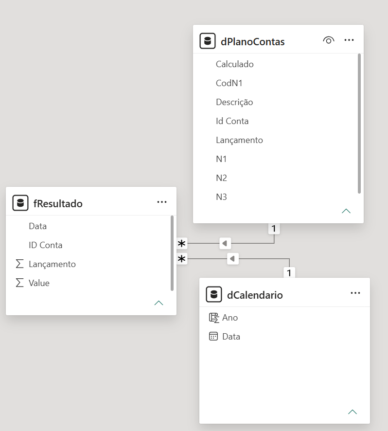

## 4. Dicionário de Dados

### 4.1 Tabela dimensão “dPlanoContas”

**Finalidade da tabela:** estruturar e organizar o plano de contas utilizado na DRE, armazenando a identificação, descrição e classificação hierárquica de cada conta. A dimensão permite agrupar e analisar os resultados financeiros pelos diferentes níveis da estrutura contábil e fornece as informações necessárias para classificação das contas presentes na fResultado.granularidade de uma única conta do plano de contas.

| **Id Conta**   | Texto   | Código identificador da conta na estrutura da DRE. O padrão do código também representa sua posição na hierarquia do plano de contas.                                              |
|----------------|---------|------------------------------------------------------------------------------------------------------------------------------------------------------------------------------------|
| **Descrição**  | Texto   | Nome ou descrição correspondente à conta identificada em Id Conta.                                                                                                                 |
| **Lançamento** | Inteiro | Indicador que identifica se a conta recebe valores de lançamento. 1 indica conta de lançamento e 0 indica que não recebe lançamento diretamente, segundo a lógica booleana.        |
| **Calculado**  | Inteiro | Indicador que identifica contas cujo resultado é obtido por cálculo a partir de outras contas. 1 indica conta calculada e 0 indica conta não calculada, segundo a lógica booleana. |
| **N1**         | Texto   | Descrição do primeiro nível hierárquico ao qual a conta pertence. Representa o nível mais abrangente da estrutura.                                                                 |
| **N2**         | Texto   | Descrição do segundo nível hierárquico ao qual a conta pertence. Utilizado para agrupar contas subordinadas dentro de N1.                                                          |
| **N3**         | Texto   | Descrição do terceiro nível hierárquico ao qual a conta pertence, representando o nível mais detalhado da hierarquia criada no modelo.                                             |
| **CodN1**      | Texto   | Código da conta correspondente ao primeiro nível (N1). Permite identificar e agrupar as contas pelo código de sua categoria hierárquica principal.                                 |

### 4.2 Tabela fato “fResultado”

**Finalidade da tabela:** armazenar os valores financeiros da DRE por conta e período de referência, funcionando como a tabela fato central do modelo. Por meio dos relacionamentos com dPlanoContas e dCalendario, permite analisar, agregar e comparar os resultados financeiros por conta, nível hierárquico e período, granularidade de valor de uma conta de lançamento em uma determinada data de referência.

| **ID Conta**   | Texto   | Código identificador da conta à qual o resultado financeiro está associado. Utilizado para relacionar a tabela fato à dimensão dPlanoContas.                             |
|----------------|---------|--------------------------------------------------------------------------------------------------------------------------------------------------------------------------|
| **Data**       | Data    | Data de referência do exercício ao qual o valor financeiro pertence. Utilizada no relacionamento com a dimensão dCalendario e nas análises temporais.                    |
| **Value**      | Número  | Valor financeiro registrado para determinada conta e período. Valores positivos e negativos representam os valores conforme a natureza e apresentação das contas na DRE. |
| **Lançamento** | Inteiro | Indicador que identifica registros correspondentes a contas de lançamento. 1 indica conta de lançamento.                                                                 |

### 4.3 Tabela dimensão “dCalendário”

**Finalidade da tabela:** fornecer uma dimensão temporal contínua para o modelo, permitindo relacionar os registros da “fResultado” às respectivas datas e realizar análises e comparações entre exercícios, com granularidade de dia único por ano.

| **Data** | DataHora       | Contém uma sequência contínua de datas utilizada como referência temporal do modelo. Funciona como chave para o relacionamento entre a dimensão calendário e a tabela fato fResultado. |
|----------|----------------|----------------------------------------------------------------------------------------------------------------------------------------------------------------------------------------|
| **Ano**  | Número inteiro | Ano correspondente a cada data, utilizado para agrupamento, filtragem e comparação dos resultados entre diferentes exercícios.                                                         |

## 5. Mapeamento de Métricas e Indicadores

Após a estruturação e modelagem dos dados, foram desenvolvidas medidas em DAX para representar os resultados da DRE, analisar o desempenho financeiro da empresa e permitir a construção de cenários simulados.

Para facilitar a organização e a interpretação do modelo, as medidas foram divididas em três grupos de acordo com sua finalidade: **DRE, Análise Financeira** e **Simulador.**

### 5.1 DRE — Estrutura dos Resultados

O primeiro grupo reúne as medidas responsáveis pela construção da Demonstração do Resultado do Exercício (DRE). Os cálculos utilizam os valores armazenados na tabela fato fResultado e a classificação das contas presente na dimensão dPlanoContas.

Foram desenvolvidas medidas para **Receita de Vendas, Custos, Despesas, Resultado Bruto, Resultado Financeiro, EBIT, EBT, Impostos e Resultado Final,** além de medidas auxiliares utilizadas na apresentação e comparação da DRE entre exercícios.

Essa camada constitui a base dos cálculos financeiros do modelo e fornece os resultados utilizados posteriormente nos indicadores de desempenho e nas simulações de cenários.

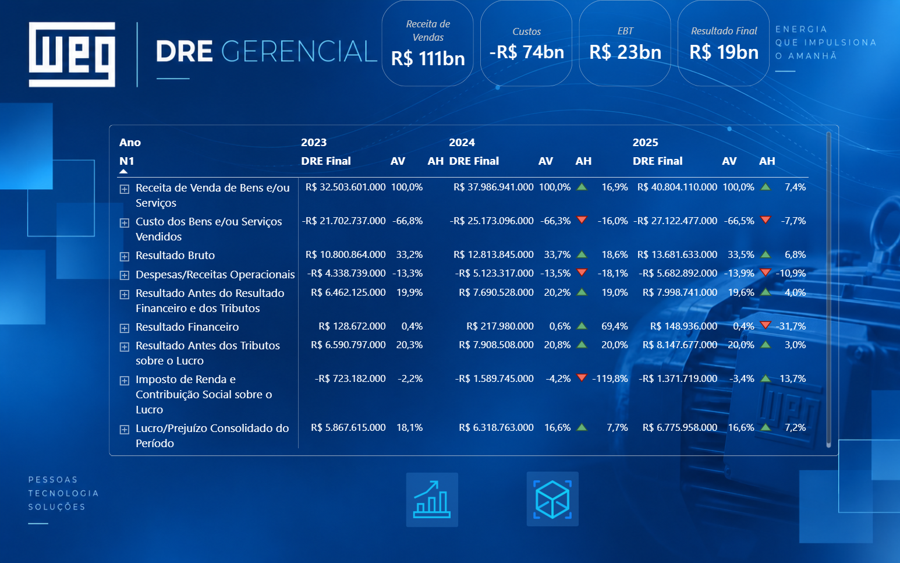

### 5.2 Análise Financeira — Indicadores de Desempenho

A partir dos resultados calculados na DRE, foi criada uma segunda camada de medidas destinada à análise da evolução, rentabilidade e eficiência financeira da empresa.

Foram implementados indicadores de **Análise Horizontal (AH) para Receita, EBIT e Resultado Final,** permitindo mensurar a variação dos resultados entre períodos.

Também foram desenvolvidas as métricas **Margem Bruta, Margem EBIT e Margem Líquida,** além dos indicadores **Cost-to-Revenue e OpEx-to-Revenue,** utilizados para avaliar a relação entre custos, despesas e geração de receita.

Para complementar a análise da evolução dos resultados ao longo do período estudado, foram calculados o **CAGR da Receita** e o **CAGR do Resultado Final,** representando a taxa composta de crescimento dessas métricas.

Dessa forma, enquanto a DRE apresenta e estrutura os resultados financeiros, a camada de Análise Financeira permite visualizar seu comportamento e evolução sob diferentes perspectivas.

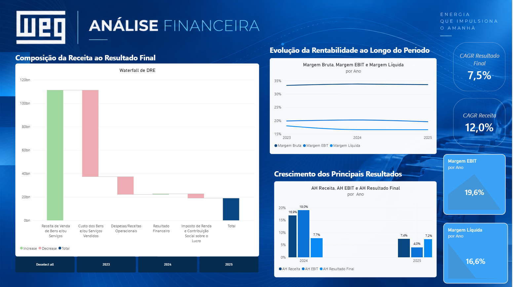

### 5.3 Simulador — Análise de Cenários

O terceiro grupo de medidas foi desenvolvido para permitir a realização de simulações de cenários por meio de parâmetros What-if/WIF (Do português “E Se”).

O usuário pode aplicar variações sobre **Receita, Custos, Despesas, Resultado Financeiro e Impostos**. A partir dessas alterações, o modelo recalcula os valores correspondentes de **Resultado Bruto, EBIT, EBT e Resultado Final**, gerando uma nova projeção financeira para o cenário selecionado.

Além dos valores simulados, foram criadas medidas de variação para comparar cada resultado projetado ao respectivo valor original. Isso permite identificar o impacto das alterações aplicadas sobre os diferentes componentes da DRE e sobre o resultado final.

A estrutura do simulador complementa a análise histórica do modelo, permitindo não apenas observar o desempenho registrado, mas também explorar os possíveis efeitos de diferentes cenários financeiros até seu resultado final.

## 6. Métricas e Indicadores (Power BI-DAX)

### 6.1 Estrutura

O modelo analítico utiliza um conjunto de medidas DAX responsáveis pela construção da DRE, pelo cálculo de indicadores de desempenho financeiro e pela simulação de cenários.

Para facilitar a organização, manutenção e interpretação do modelo, as medidas foram divididas em três grupos de acordo com sua finalidade: **DRE, Análise Financeira e Simulador**.

**DRE — Estrutura dos Resultados**

As medidas deste grupo são responsáveis pela composição da Demonstração do Resultado do Exercício e constituem a base para os demais cálculos do modelo.

- Receita de Vendas

- Custos

- Despesas

- Resultado Bruto

- Resultado Financeiro

- EBIT

- EBT

- Impostos de Renda/Contribuição

- Resultado Final

- DRE

- DRE Final

- DRE Final Ano Anterior

**Análise Financeira — Indicadores de Desempenho**

As medidas de análise financeira utilizam os resultados da DRE para avaliar a evolução, rentabilidade e eficiência financeira da empresa.

- AH Receita

- AH EBIT

- AH Resultado Final

- CAGR Receita

- CAGR Resultado Final

- Margem Bruta

- Margem EBIT

- Margem Líquida

- Cost-to-Revenue

- OpEx-to-Revenue

**Simulador — Análise de Cenários**

As medidas do simulador utilizam parâmetros What-if para calcular cenários hipotéticos e mensurar as variações em relação aos resultados originais.

- Receita WIF

- Custo WIF

- Despesas WIF

- Financeiro WIF

- Imposto WIF

- Resultado Bruto WIF

- EBIT WIF

- EBT WIF

- Resultado Final Simulado

- Var Receita

- Var Custo

- Var Despesas

- Var Financeiro

- Var Imposto

- Var Bruto

- Var EBIT

- Var EBT

- Var Resultado Final

### 6.2 Dicionário de Métricas

| **Nome da Medida (DAX)**           | **Grupo**          | **Expressão**                                                                                                                                                                                                                                                                                                                    | **O que calcula**                                                                              | **Finalidade no modelo**                                                                          |
|------------------------------------|--------------------|----------------------------------------------------------------------------------------------------------------------------------------------------------------------------------------------------------------------------------------------------------------------------------------------------------------------------------|------------------------------------------------------------------------------------------------|---------------------------------------------------------------------------------------------------|
| **Receita de Vendas**              | DRE                | Receita de Vendas = CALCULATE(\[Resultado Final\],dPlanoContas\[CodN1\]="3.01")                                                                                                                                                                                                                                                  | Calcula o valor das receitas de vendas no contexto selecionado.                                | Representa a receita utilizada como base para a construção da DRE e dos indicadores derivados.    |
| **Custos**                         | DRE                | Custos = CALCULATE(\[Resultado Final\],dPlanoContas\[CodN1\]="3.02")                                                                                                                                                                                                                                                             | Calcula os custos associados aos bens e/ou serviços vendidos.                                  | Permite mensurar os custos diretamente relacionados à geração da receita.                         |
| **Despesas**                       | DRE                | Despesas = CALCULATE(\[Resultado Final\],dPlanoContas\[CodN1\]="3.04")                                                                                                                                                                                                                                                           | Calcula o total das despesas operacionais consideradas no modelo.                              | Permite mensurar o impacto das despesas sobre o resultado operacional.                            |
| **Resultado Bruto**                | **DRE**            | Resultado Bruto = \[Receita Bruta\]+\[Custos\]                                                                                                                                                                                                                                                                                   | Calcula o resultado obtido após a consideração da receita e dos custos.                        | Representa o resultado da operação antes das despesas e demais componentes da DRE.                |
| **Resultado Financeiro**           | DRE                | Resultado Financeiro = CALCULATE(\[Resultado Final\],dPlanoContas\[CodN1\]="3.06")                                                                                                                                                                                                                                               | Calcula o resultado proveniente das receitas e despesas financeiras.                           | Evidencia o impacto do resultado financeiro sobre o desempenho da empresa.                        |
| **EBIT**                           | DRE                | EBIT = \[Receita Bruta\]+\[Custos\]+\[Despesas\]                                                                                                                                                                                                                                                                                 | Calcula o resultado operacional antes dos juros e tributos.                                    | Permite avaliar o desempenho das operações antes dos efeitos financeiros e tributários.           |
| **EBT**                            | DRE                | EBT = CALCULATE(\[DRE Final\],dPlanoContas\[CodN1\]="3.07")                                                                                                                                                                                                                                                                      | Calcula o resultado antes da incidência dos tributos sobre o lucro.                            | Representa o resultado após os efeitos operacionais e financeiros e antes dos impostos.           |
| **Impostos de Renda/Contribuição** | DRE                | Impostos de Renda/Contribuição = CALCULATE(\[Resultado Final\],dPlanoContas\[CodN1\]="3.08")                                                                                                                                                                                                                                     | Calcula os valores referentes ao Imposto de Renda e à Contribuição Social.                     | Incorpora o efeito da tributação sobre o resultado da empresa.                                    |
| **Resultado Final**                | DRE                | Resutado Final = SUM(fResultado\[Value\])                                                                                                                                                                                                                                                                                        | Calcula o resultado final obtido após todos os componentes da DRE.                             | Representa o resultado líquido do período analisado.                                              |
| **DRE**                            | DRE                | DRE = CALCULATE(\[Resultado Final\],FILTER(ALL(dPlanoContas),dPlanoContas\[CodN1\]\<SELECTEDVALUE(dPlanoContas\[CodN1\])))                                                                                                                                                                                                       | Calcula os valores acumulados conforme a posição das contas na estrutura da DRE.               | Permite construir as linhas calculadas da demonstração a partir da hierarquia do plano de contas. |
| **DRE Final**                      | DRE                | DRE Final = IF(SELECTEDVALUE(dPlanoContas\[Calculado\])=1,\[DRE\],\[Resultado Final\])                                                                                                                                                                                                                                           | Define se cada linha deve apresentar um resultado calculado ou o valor diretamente registrado. | Permite apresentar, na mesma estrutura, contas de lançamento e contas calculadas.                 |
| **AV**                             | DRE                | AV = DIVIDE(\[DRE Final\],CALCULATE(\[DRE Final\],All(dPlanoContas),dPlanoContas\[CodN1\]="3.01"))                                                                                                                                                                                                                               | Calcula a participação percentual de cada linha da DRE em relação à Receita de Vendas.         | Permite realizar a Análise Vertical e avaliar o peso relativo de cada componente da DRE.          |
| **DRE Final Ano Anterior**         | DRE                | DRE Final Ano Anterior = CALCULATE(\[DRE Final\],SAMEPERIODLASTYEAR(dCalendario\[Data\])                                                                                                                                                                                                                                         | Recupera o valor da DRE correspondente ao mesmo período do ano anterior.                       | Fornece a referência temporal utilizada nas comparações entre exercícios.                         |
| **AH**                             | DRE                | AH = DIVIDE(\[DRE Final\]-\[DRE Final Ano Anterior\],ABS(\[DRE Final Ano Anterior\]))                                                                                                                                                                                                                                            | Calcula a variação percentual da DRE em relação ao mesmo período do ano anterior.              | Permite realizar a Análise Horizontal e identificar aumentos ou reduções entre exercícios.        |
| **AH Receita**                     | Análise Financeira | AH Receita = VAR AnoAtual = SELECTEDVALUE(dCalendario\[Ano\]) VAR ReceitaAtual = \[Receita de Vendas\] VAR ReceitaAnterior = CALCULATE(\[Receita de Vendas\], FILTER(ALL(dCalendario), dCalendario\[Ano\] = AnoAtual - 1)) RETURN IF(ISBLANK(ReceitaAnterior), BLANK(), DIVIDE(ReceitaAtual, ReceitaAnterior) - 1)               | Calcula a variação da Receita em relação ao período de comparação.                             | Permite identificar crescimento ou retração da receita entre períodos.                            |
| **AH EBIT**                        | Análise Financeira | AH EBIT = VAR AnoAtual = SELECTEDVALUE(dCalendario\[Ano\]) VAR EBITAtual = \[EBIT\] VAR EBITAnterior = CALCULATE(\[EBIT\], FILTER(ALL(dCalendario), dCalendario\[Ano\] = AnoAtual - 1)) RETURN IF(ISBLANK(EBITAnterior), BLANK(), DIVIDE(EBITAtual, EBITAnterior) - 1)                                                           | Calcula a variação do EBIT entre períodos comparáveis.                                         | Permite acompanhar a evolução do desempenho operacional.                                          |
| **AH Resultado Final**             | Análise Financeira | AH Resultado Final = VAR AnoAtual = SELECTEDVALUE(dCalendario\[Ano\]) VAR ResultadoAtual = \[Resultado Final\] VAR ResultadoAnterior = CALCULATE(\[Resultado Final\], FILTER(ALL(dCalendario), dCalendario\[Ano\] = AnoAtual - 1)) RETURN IF(ISBLANK(ResultadoAnterior), BLANK(), DIVIDE(ResultadoAtual, ResultadoAnterior) - 1) | Calcula a variação do Resultado Final entre períodos.                                          | Permite avaliar a evolução do resultado líquido da empresa.                                       |
| **CAGR Receita**                   | Análise Financeira | CAGR Receita = VAR ReceitaInicial = CALCULATE(\[Receita de Vendas\],dCalendario\[Ano\] = 2023) VAR ReceitaFinal =CALCULATE(\[Receita de Vendas\],dCalendario\[Ano\] = 2025) RETURN POWER(DIVIDE(ReceitaFinal, ReceitaInicial),1 / 2) - 1                                                                                         | Calcula a taxa composta de crescimento da Receita.                                             | Mensura o ritmo médio de crescimento da receita ao longo do período analisado.                    |
| **CAGR Resultado Final**           | Análise Financeira | CAGR Resultado Final = VAR ResultadoInicial =CALCULATE(\[Resultado Final\],dCalendario\[Ano\] = 2023)VAR ResultadoFinal =CALCULATE(\[Resultado Final\],dCalendario\[Ano\] = 2025)RETURN POWER(DIVIDE(ResultadoFinal, ResultadoInicial),1 / 2) - 1                                                                                | Calcula a taxa composta de crescimento do Resultado Final.                                     | Mensura a evolução média do resultado final ao longo do período analisado.                        |
| **Margem Bruta**                   | Análise Financeira | Margem Bruta = \[Resultado Bruto\]/\[Receita de Vendas\]                                                                                                                                                                                                                                                                         | Calcula a relação entre Resultado Bruto e Receita.                                             | Indica a parcela da receita remanescente após a consideração dos custos.                          |
| **Margem EBIT**                    | Análise Financeira | Margem EBIT = \[EBIT\]/\[Receita de Vendas\]                                                                                                                                                                                                                                                                                     | Calcula a relação entre EBIT e Receita.                                                        | Permite avaliar a rentabilidade operacional em relação à receita.                                 |
| **Margem Líquida**                 | Análise Financeira | Margem Líquida = \[Resultado Final\]/\[Receita de Vendas\]                                                                                                                                                                                                                                                                       | Calcula a relação entre Resultado Final e Receita.                                             | Indica a proporção da receita convertida em resultado líquido.                                    |
| **Cost-to-Revenue**                | Análise Financeira | Cost-to-Revenue = \[Custos\]/\[Receita de Vendas\]                                                                                                                                                                                                                                                                               | Calcula a proporção dos custos em relação à Receita.                                           | Permite acompanhar o peso dos custos sobre a geração de receita.                                  |
| **OpEx-to-Revenue**                | Análise Financeira | OpEx-to-Revenue = \[Despesas\]/\[Receita de Vendas\]                                                                                                                                                                                                                                                                             | Calcula a proporção das despesas operacionais em relação à Receita.                            | Permite avaliar o peso das despesas operacionais sobre a receita.                                 |
| **Receita WIF**                    | Simulador          | Receita WIF = \[Receita Bruta\]\*(1+\[WIF Receita Valor\])                                                                                                                                                                                                                                                                       | Calcula a Receita após a aplicação do parâmetro de simulação.                                  | Permite testar cenários de aumento ou redução da receita.                                         |
| **Custo WIF**                      | Simulador          | Custo WIF = \[Custos\]\*(1+\[WIF Custo Value\])                                                                                                                                                                                                                                                                                  | Calcula os Custos após a aplicação do parâmetro de simulação.                                  | Permite avaliar o efeito de alterações nos custos.                                                |
| **Despesas WIF**                   | Simulador          | Despesas WIF = \[Despesas\]\*(1+\[WIF Despesas Value\])                                                                                                                                                                                                                                                                          | Calcula as Despesas após a aplicação do parâmetro de simulação.                                | Permite avaliar o efeito de alterações nas despesas.                                              |
| **Financeiro WIF**                 | Simulador          | Financeiro WIF = \[Resultado Financeiro\]\*(1+\[WIF Financeiro Value\])                                                                                                                                                                                                                                                          | Calcula o Resultado Financeiro conforme o cenário simulado.                                    | Permite incorporar alterações do resultado financeiro ao cenário projetado.                       |
| **Imposto WIF**                    | Simulador          | Imposto WIF = \[Impostos de Renda/Contribuição\]\*(1+ \[WIF Imposto Value\])                                                                                                                                                                                                                                                     | Calcula os Impostos conforme os valores resultantes do cenário simulado.                       | Permite incorporar o efeito tributário à projeção financeira.                                     |
| **Resultado Bruto WIF**            | Simulador          | Resultado Bruto WIF = \[Receita WIF\]+\[Custo WIF\]                                                                                                                                                                                                                                                                              | Calcula o Resultado Bruto com base nos valores simulados de Receita e Custos.                  | Demonstra o impacto das premissas simuladas sobre o resultado bruto.                              |
| **EBIT WIF**                       | Simulador          | EBIT WIF = \[Receita WIF\]+\[Custo WIF\]+\[Despesas WIF\]                                                                                                                                                                                                                                                                        | Calcula o EBIT resultante do cenário simulado.                                                 | Demonstra o impacto das alterações simuladas sobre o resultado operacional.                       |
| **EBT WIF**                        | Simulador          | EBT WIF = \[Receita WIF\]+\[Custo WIF\]+\[Despesas WIF\]+\[Financeiro WIF\]                                                                                                                                                                                                                                                      | Calcula o resultado antes dos tributos no cenário simulado.                                    | Permite avaliar o resultado projetado após os efeitos operacionais e financeiros.                 |
| **Resultado Final Simulado**       | Simulador          | Resultado Final Simulado = \[Receita WIF\]+\[Custo WIF\]+\[Despesas WIF\]+\[Financeiro WIF\]+\[Imposto WIF\]                                                                                                                                                                                                                     | Calcula o resultado final após a aplicação das premissas do cenário.                           | Consolida os efeitos das alterações simuladas sobre o resultado final.                            |
| **Var Resultado Final**            | Simulador          | Var Resultado Final = \[Resultado Final Simulado\]-\[Resultado Final\]                                                                                                                                                                                                                                                           | Calcula a diferença entre o Resultado Final simulado e o resultado original.                   | Quantifica o impacto consolidado do cenário sobre o resultado final.                              |
| **Var Receita**                    | Simulador          | Var Receita = \[Receita WIF\]-\[Receita Bruta\]                                                                                                                                                                                                                                                                                  | Calcula a diferença entre a Receita simulada e a Receita original.                             | Permite mensurar o impacto da simulação sobre a receita.                                          |
| **Var Custo**                      | Simulador          | Var Custo = \[Custo WIF\]-\[Custos\]                                                                                                                                                                                                                                                                                             | Calcula a diferença entre os Custos simulados e os Custos originais.                           | Permite mensurar o impacto da simulação sobre os custos.                                          |
| **Var Despesas**                   | Simulador          | Var Despesas = \[Despesas WIF\]-\[Despesas\]                                                                                                                                                                                                                                                                                     | Calcula a diferença entre as Despesas simuladas e as Despesas originais.                       | Permite mensurar o impacto da simulação sobre as despesas.                                        |
| **Var Bruto**                      | Simulador          | Var Bruto= \[Resultado Bruto WIF\]-\[Resultado Bruto\]                                                                                                                                                                                                                                                                           | Calcula a diferença entre o Resultado Bruto simulado e o Resultado Bruto original.             | Permite mensurar o impacto da simulação sobre o resultado bruto.                                  |
| **Var EBIT**                       | Simulador          | Var EBIT = \[EBIT WIF\]-\[EBIT\]                                                                                                                                                                                                                                                                                                 | Calcula a diferença entre o EBIT simulado e o EBIT original.                                   | Permite mensurar o impacto da simulação sobre o resultado operacional.                            |
| **Var Financeiro**                 | Simulador          | Var Financeiro = \[Financeiro WIF\]-\[Resultado Financeiro\]                                                                                                                                                                                                                                                                     | Calcula a diferença entre o Resultado Financeiro simulado e o Resultado Financeiro original.   | Permite mensurar o impacto da simulação sobre o resultado financeiro.                             |
| **Var EBT**                        | Simulador          | Var EBT = \[EBT WIF\]-\[EBT\]                                                                                                                                                                                                                                                                                                    | Calcula a diferença entre o EBT simulado e o EBT original.                                     | Permite mensurar o impacto da simulação sobre o resultado antes dos tributos.                     |
| **Var Imposto**                    | Simulador          | Var Imposto = \[Imposto WIF\]-\[Impostos de Renda/Contribuição\]                                                                                                                                                                                                                                                                 | Calcula a diferença entre os Impostos simulados e os valores originais.                        | Permite mensurar o impacto tributário decorrente do cenário simulado.                             |

## 7. Visualizações Analíticas

As visualizações analíticas foram desenvolvidas com o objetivo de transformar os dados estruturados no modelo em informações financeiras de fácil interpretação. O dashboard foi organizado em três páginas — **DRE Gerencial, Análise Financeira e Simulador de Resultado** — que permitem acompanhar a composição dos resultados, avaliar a evolução do desempenho financeiro e simular diferentes cenários.

### 7.1 DRE Gerencial

A página DRE Gerencial apresenta uma visão consolidada da Demonstração do Resultado do Exercício, permitindo acompanhar os principais resultados financeiros e analisar sua composição e evolução ao longo dos períodos disponíveis.

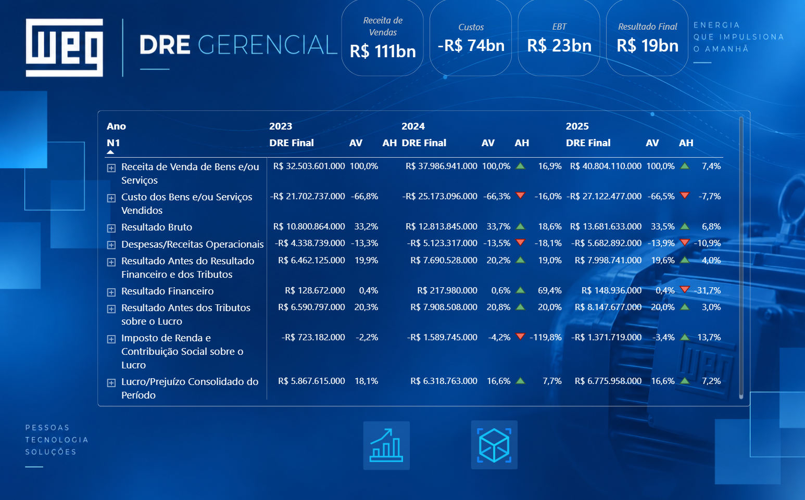

#### 7.1.1 Cartões Executivos — Principais Resultados da DRE

**Medidas utilizadas:**

- Receita de Vendas

- Custos

- EBT

- Resultado Final

Os cartões executivos apresentam uma visão rápida dos principais resultados da DRE no contexto selecionado. **Receita de Vendas** representa os valores provenientes da venda de bens e/ou serviços; **Custos** evidencia os valores diretamente relacionados à geração dessas receitas; **EBT** apresenta o resultado antes da incidência dos tributos sobre o lucro; e **Resultado Final** demonstra o lucro ou prejuízo consolidado do período.

A visualização permite identificar rapidamente a dimensão dos principais componentes do resultado antes de avançar para a análise detalhada da demonstração.

#### 7.1.2 Matriz da DRE — Análise Vertical e Horizontal

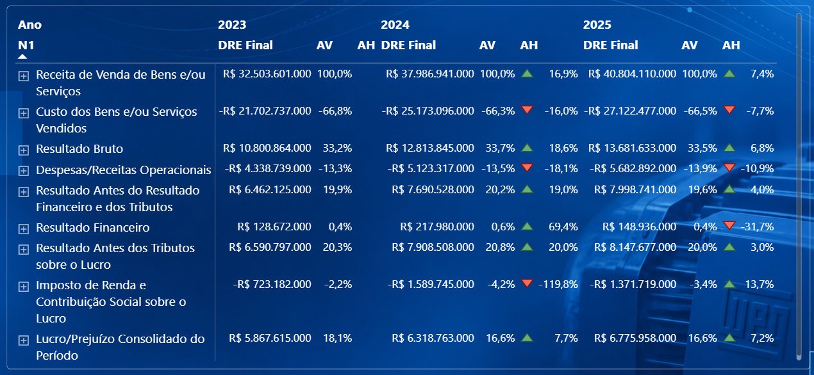

**Campos e medidas utilizados:**

- Ano

- N1

- DRE Final

- AV

- AH

A matriz apresenta a estrutura da DRE distribuída pelos exercícios analisados. A medida **DRE Final** apresenta os valores correspondentes às diferentes linhas da demonstração, enquanto a **Análise Vertical (AV)** demonstra a participação percentual de cada componente em relação à Receita de Vendas.

A **Análise Horizontal (AH)** evidencia a variação percentual de cada linha em relação ao exercício anterior. Os indicadores visuais de aumento e redução facilitam a identificação das principais mudanças entre os períodos, enquanto a hierarquia do plano de contas possibilita expandir a estrutura para níveis mais detalhados de análise.

### 7.2 Análise Financeira

A página Análise Financeira complementa a leitura da DRE por meio de visualizações voltadas à composição do resultado, rentabilidade e crescimento. Os indicadores permitem observar não apenas os valores financeiros, mas também sua evolução e relação com a receita ao longo dos exercícios.

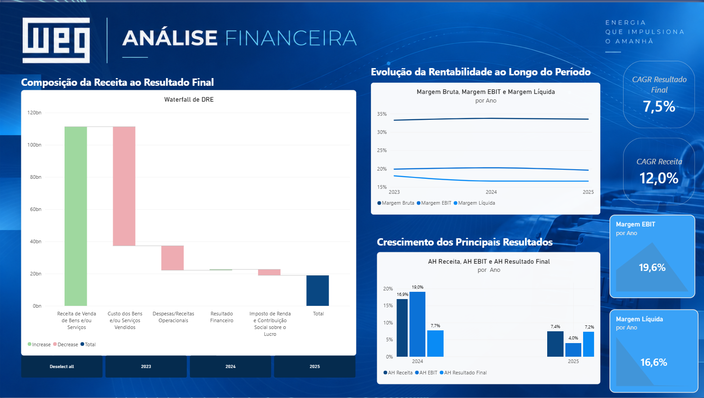

#### 7.2.1 Composição da Receita ao Resultado Final — Waterfall

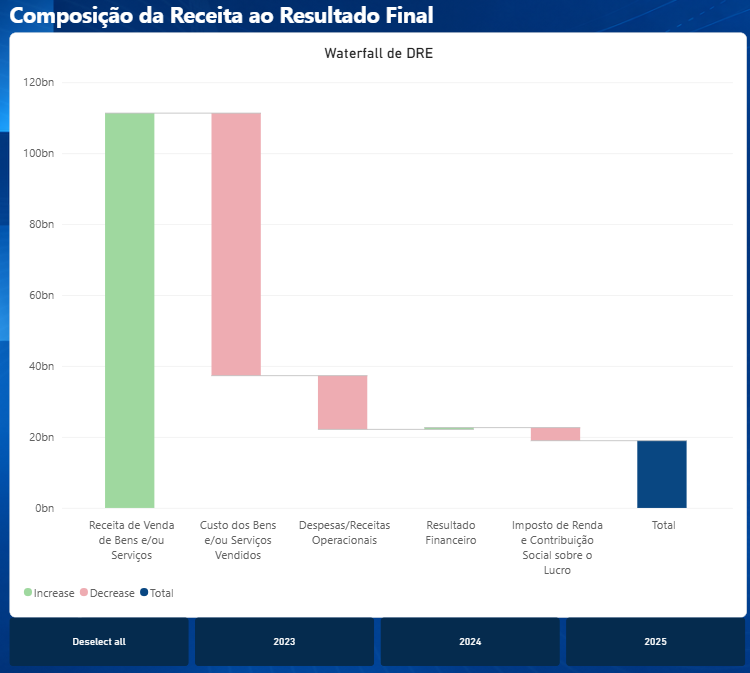

**Medidas utilizadas:**

- Receita de Vendas

- Custos

- Despesas

- Resultado Financeiro

- Impostos de Renda/Contribuição

- Resultado Final

O **gráfico de cascata** (***Waterfall***) demonstra o processo de formação do **Resultado Final** a partir da **Receita de Vendas**. **Custos, despesas, resultado financeiro e tributos** são apresentados conforme seus respectivos impactos sobre o resultado.

A visualização permite compreender de forma sequencial como cada componente da DRE contribui positiva ou negativamente para transformar a receita inicial no resultado consolidado do período.

#### 7.2.2 Evolução da Rentabilidade ao Longo do Período

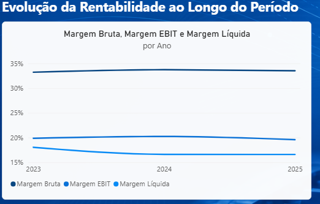

**Medidas utilizadas:**

- Margem Bruta

- Margem EBIT

- Margem Líquida

O gráfico de linhas apresenta a evolução das principais margens de rentabilidade ao longo dos exercícios analisados. A **Margem Bruta** demonstra a parcela da receita remanescente após os custos; a **Margem EBIT** evidencia a rentabilidade operacional; e a **Margem Líquida** representa a proporção da receita convertida em resultado final.

A comparação das três margens permite acompanhar mudanças na estrutura de rentabilidade da empresa e identificar variações na eficiência da geração de resultados ao longo do período.

#### 7.2.3 Crescimento dos Principais Resultados

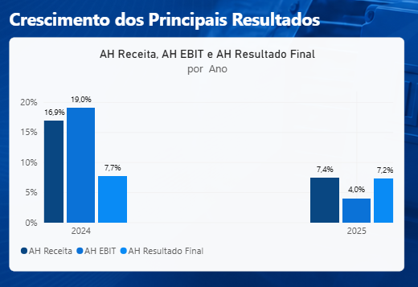

**Medidas utilizadas:**

- AH Receita

- AH EBIT

- AH Resultado Final

O gráfico compara as variações anuais da **Receita de Vendas, EBIT e Resultado Final** em relação ao exercício anterior. As medidas de **Análise Horizontal** permitem observar se os principais resultados financeiros apresentaram crescimento ou redução entre os períodos.

A visualização possibilita comparar o ritmo de crescimento da receita com a evolução do resultado operacional e do resultado final, auxiliando na identificação de diferenças entre crescimento e rentabilidade.

#### 7.2.4 Indicadores de Crescimento — CAGR

 

**Medidas utilizadas:**

- CAGR Receita

- CAGR Resultado Final

Os cartões de **CAGR (*Compound Annual Growth Rate*)** apresentam a taxa composta de crescimento da **Receita de Vendas e do Resultado Final** ao longo do período analisado.

Esses indicadores sintetizam a evolução dos resultados em uma taxa média anual composta, permitindo comparar o ritmo de crescimento da receita com o crescimento do resultado final ao longo dos exercícios.

#### 7.2.5 Indicadores de Rentabilidade

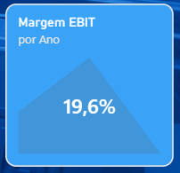 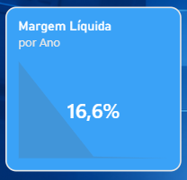

**Medidas utilizadas:**

- Margem EBIT

- Margem Líquida

Os cartões destacam os indicadores de **Margem EBIT e Margem Líquida** no contexto selecionado. A **Margem EBIT** representa a proporção da receita convertida em resultado operacional, enquanto a **Margem Líquida** demonstra a parcela da receita efetivamente convertida em resultado final.

A visualização oferece uma leitura imediata da rentabilidade operacional e final da empresa e complementa a análise histórica apresentada no gráfico de evolução das margens.

### 7.3 Simulador de Resultado

A página Simulador de Resultado foi desenvolvida para permitir a construção de cenários financeiros por meio de parâmetros *What-if*. O usuário pode alterar premissas relacionadas à Receita, Custos, Despesas, Resultado Financeiro e Impostos e observar seus efeitos sobre as diferentes etapas da DRE.

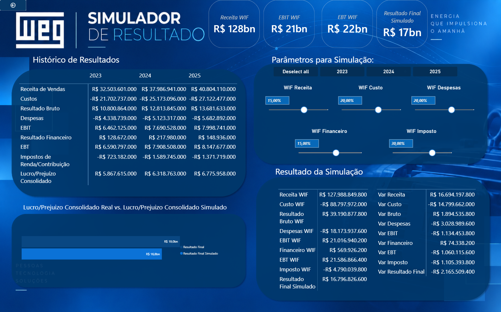

#### 7.3.1 Histórico de Resultados

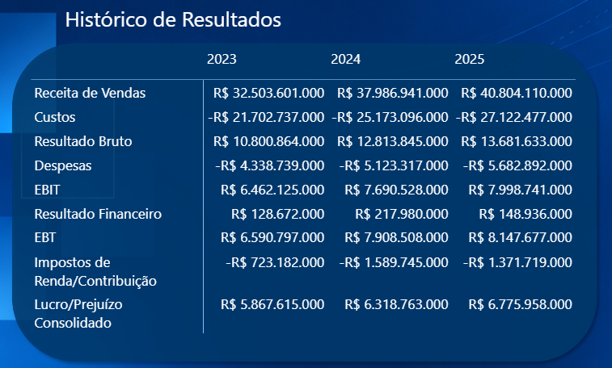

**Medidas utilizadas:**

- Receita de Vendas

- Custos

- Resultado Bruto

- Despesas

- EBIT

- Resultado Financeiro

- EBT

- Impostos de Renda/Contribuição

- Resultado Final

A matriz apresenta os valores históricos dos principais componentes da DRE para os exercícios disponíveis. Ela funciona como referência para a construção dos cenários, permitindo comparar os valores originalmente registrados com os resultados posteriormente obtidos na simulação.

#### 7.3.2 Parâmetros para Simulação — What-if

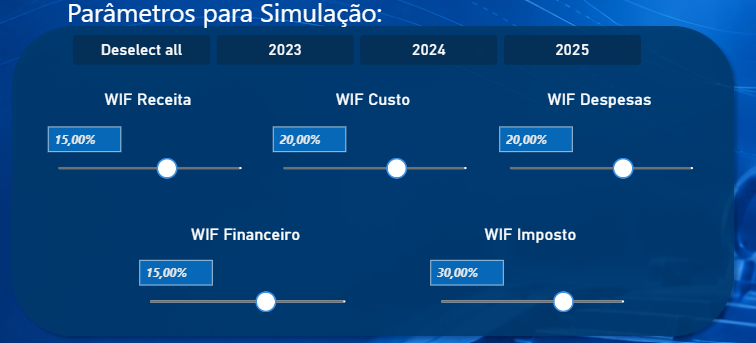

**Parâmetros utilizados:**

- WIF Receita

- WIF Custo

- WIF Despesas

- WIF Financeiro

- WIF Imposto

Os parâmetros *What-if* permitem aplicar variações percentuais independentes aos principais componentes da DRE. O usuário pode testar hipóteses de aumento ou **redução da receita, custos, despesas, resultado financeiro e impostos**.

A interação com os parâmetros recalcula dinamicamente as medidas do simulador, permitindo observar como diferentes premissas afetam a formação do resultado.

#### 7.3.3 Cartões — Principais Resultados Simulados

**Medidas utilizadas:**

- Receita WIF

- EBIT WIF

- EBT WIF

- Resultado Final Simulado

Os cartões apresentam os principais resultados obtidos após a aplicação das premissas definidas no simulador. São destacados a **Receita simulada, o EBIT simulado, o EBT simulado e o Resultado Final Simulado.**

A visualização permite verificar imediatamente o impacto consolidado das alterações realizadas nos parâmetros antes de analisar detalhadamente cada componente do cenário.

#### 7.3.4 Resultado da Simulação

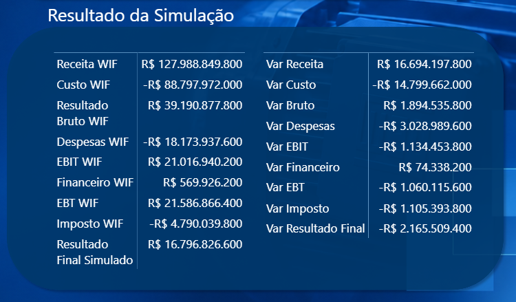

**Medidas utilizadas:**

- Receita WIF

- Custo WIF

- Resultado Bruto WIF

- Despesas WIF

- EBIT WIF

- Financeiro WIF

- EBT WIF

- Imposto WIF

- Resultado Final Simulado

A tabela apresenta a recomposição da DRE a partir dos valores calculados no cenário simulado. Cada etapa é recalculada considerando as alterações definidas nos parâmetros *What-if*, permitindo acompanhar seus efeitos desde a Receita até o Resultado Final.

Essa visualização possibilita analisar de forma detalhada como as alterações das premissas se propagam pela estrutura da demonstração financeira.

#### 7.3.5 Variações do Cenário Simulado

**Medidas utilizadas:**

- Var Receita

- Var Custo

- Var Bruto

- Var Despesas

- Var EBIT

- Var Financeiro

- Var EBT

- Var Imposto

- Var Resultado Final

A tabela de variações apresenta a diferença entre os valores obtidos no cenário simulado e os respectivos valores originais. Dessa forma, é possível mensurar individualmente o impacto das premissas sobre cada etapa da DRE.

A análise permite identificar quais componentes apresentam as maiores alterações e acompanhar como essas variações contribuem para a diferença observada no Resultado Final.

#### 7.3.6 Resultado Final Real vs. Resultado Final Simulado

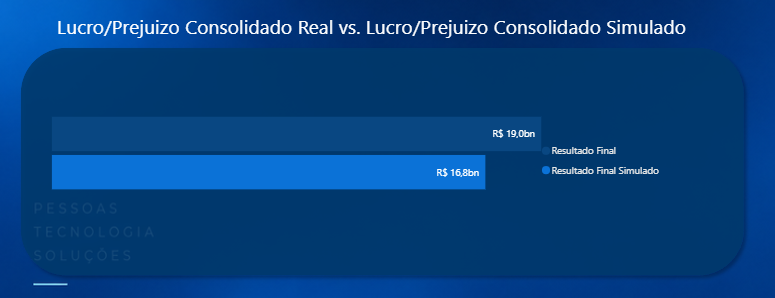

**Medidas utilizadas:**

- Resultado Final

- Resultado Final Simulado

O gráfico compara diretamente o Resultado Final original com o Resultado Final obtido no cenário simulado.

A visualização sintetiza o efeito consolidado das premissas aplicadas, permitindo identificar de maneira imediata a diferença entre o cenário histórico e o cenário projetado.

## 8. Entrega de Valor

A solução foi estruturada em três frentes complementares — **DRE Gerencial, Análise Financeira e Simulador de Resultado** — que conduzem a análise desde a compreensão dos resultados realizados até a avaliação de possíveis cenários futuros.

Essa organização permite responder a três questões fundamentais: **o que aconteceu com os resultados financeiros, como o desempenho evoluiu ao longo do período e qual seria o impacto de alterações nas principais variáveis da DRE**.

Dessa forma, o dashboard combina análise histórica, avaliação de desempenho e simulação financeira em uma única solução analítica.

### 8.1 Perspectiva de Negócio

Sob a perspectiva de negócio, a **DRE Gerencial** oferece uma visão estruturada dos resultados financeiros da empresa, permitindo acompanhar Receita, Custos, Despesas, Resultado Financeiro, Tributos e Resultado Final ao longo dos exercícios. A utilização conjunta da **Análise Vertical (AV)** e da **Análise Horizontal (AH)** permite avaliar tanto a participação de cada componente na formação do resultado quanto sua evolução entre os períodos.

A página de **Análise Financeira** aprofunda essa leitura ao incorporar indicadores de crescimento e rentabilidade. A evolução das margens, as taxas de crescimento e a comparação entre Receita, EBIT e Resultado Final permitem observar se o crescimento da empresa está sendo acompanhado pela manutenção ou melhoria de sua capacidade de geração de resultados.

O **Simulador de Resultado** acrescenta uma dimensão prospectiva à análise. Por meio de parâmetros *What-if*, é possível testar alterações em Receita, Custos, Despesas, Resultado Financeiro e Impostos e acompanhar como seus efeitos se propagam pelas diferentes etapas da DRE até o Resultado Final.

Assim, as três páginas estabelecem um fluxo analítico complementar: a **DRE Gerencial mostra o que aconteceu**, a **Análise Financeira permite compreender como o desempenho evoluiu** e o **Simulador possibilita avaliar como diferentes premissas podem alterar os resultados**.

### 8.2 Perspectiva Técnica

Do ponto de vista técnico, as três páginas foram construídas sobre uma mesma estrutura de dados e lógica analítica, garantindo **consistência entre os valores apresentados na DRE, os indicadores financeiros e os resultados simulados**.

A **DRE Gerencial** utiliza a hierarquia do plano de contas e medidas DAX para combinar contas de lançamento e linhas calculadas em uma única demonstração, incorporando ainda cálculos de Análise Vertical e Horizontal para comparação entre os exercícios.

A página de **Análise Financeira** reutiliza os resultados produzidos pela DRE como base para medidas derivadas de margem, crescimento e evolução temporal. Essa abordagem evita a duplicação desnecessária de lógica e mantém os indicadores diretamente relacionados aos resultados apresentados na demonstração financeira.

No **Simulador de Resultado**, parâmetros *What-if* são utilizados para alterar determinadas premissas sem modificar os valores históricos originais. Medidas específicas recalculam sequencialmente os componentes da DRE e permitem comparar os valores simulados com seus respectivos valores de referência.

Essa integração cria um fluxo consistente entre **dados históricos, métricas financeiras e análise de cenários**, ao mesmo tempo em que mantém separadas as medidas responsáveis pelos valores realizados e aquelas utilizadas exclusivamente na simulação.

### 8.3 Valor Entregue pela Solução

A principal entrega da solução está na integração de três níveis de análise que normalmente responderiam a necessidades distintas.

A **DRE Gerencial** fornece a visão estruturada dos resultados; a **Análise Financeira** transforma esses resultados em indicadores capazes de evidenciar tendências de crescimento e rentabilidade; e o **Simulador de Resultado** utiliza essa mesma base para testar cenários e mensurar seus possíveis impactos.

Com isso, o dashboard permite:

- **compreender a formação do Resultado Final**, acompanhando a contribuição dos diferentes componentes da DRE;

- **comparar exercícios e identificar variações relevantes** por meio das análises Vertical e Horizontal;

- **acompanhar crescimento e rentabilidade** por meio de margens, CAGR e indicadores de evolução;

- **avaliar diferentes premissas financeiras** por meio dos parâmetros *What-if*;

- **mensurar o impacto das simulações em cada etapa da DRE**, preservando os resultados históricos como referência;

- **comparar diretamente o cenário realizado e o cenário simulado**, tornando explícito o efeito das premissas adotadas.

Dessa forma, a solução não se limita à visualização de dados financeiros históricos. As três páginas formam um percurso analítico contínuo, no qual o usuário pode partir da **leitura do resultado realizado**, avançar para a **compreensão de sua evolução** e, finalmente, utilizar essas informações como base para a **exploração de diferentes cenários financeiros**.
